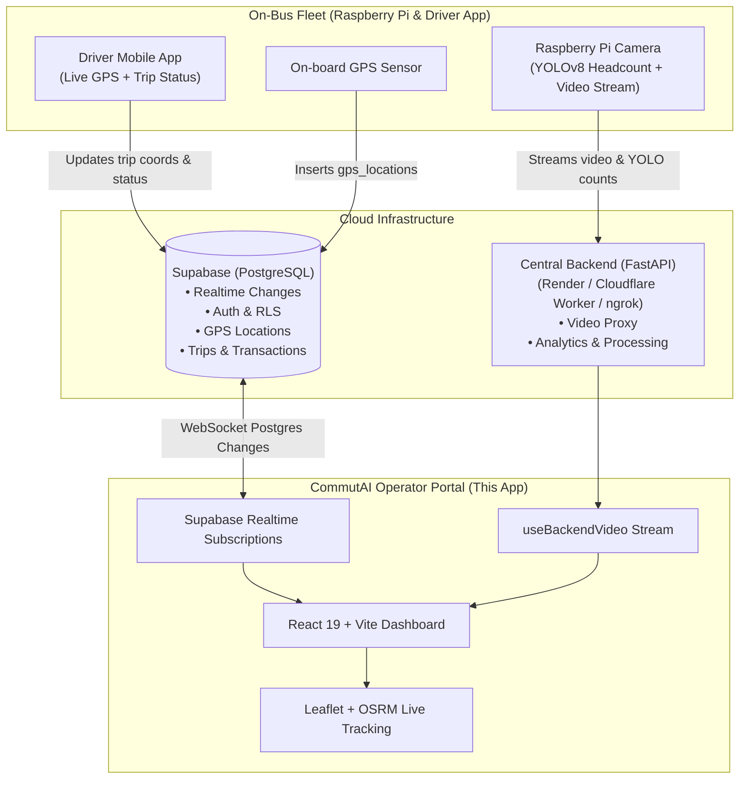

# CommutAI Operator Dashboard

[](https://vitejs.dev/)
[](https://react.dev/)
[](https://www.typescriptlang.org/)
[](https://tailwindcss.com/)
[](https://supabase.com/)

A modern, high-performance web dashboard engineered for public transport fleet operators. Built with **React 19**, **Vite**, **TypeScript**, and **Tailwind CSS v4**, the CommutAI Operator portal provides centralized real-time GPS fleet tracking, live AI video surveillance, automated passenger load reconciliation, transit card management, fare matrix administration, and comprehensive analytics.

---

## 📑 Table of Contents

- [System Architecture](#-system-architecture)
- [Key Features](#-key-features)
  - [1. Real-Time Fleet & Dashboard](#1-real-time-fleet--dashboard)
  - [2. Trip Management & History](#2-trip-management--history)
  - [3. Point-to-Point Fare Matrix](#3-point-to-point-fare-matrix)
  - [4. Card Management & Transactions](#4-card-management--transactions)
  - [5. AI Video Surveillance & Irregularity Monitoring](#5-ai-video-surveillance--irregularity-monitoring)
  - [6. Analytics & PDF Reporting](#6-analytics--pdf-reporting)
- [Tech Stack](#-tech-stack)
- [Project Structure](#-project-structure)
- [Environment Variables](#-environment-variables)
- [Getting Started](#-getting-started)
  - [Prerequisites](#prerequisites)
  - [Installation](#installation)
  - [Development Server](#development-server)
  - [Production Build](#production-build)
- [Realtime Subscriptions & Edge Integration](#-realtime-subscriptions--edge-integration)
- [Deployment](#-deployment)
- [License](#-license)

---

## 🏛 System Architecture

The CommutAI ecosystem integrates edge devices (on-bus hardware), driver mobile applications, a cloud PostgreSQL database, and a centralized FastAPI backend with this Operator Portal.



---

## ✨ Key Features

### 1. Real-Time Fleet & Dashboard
- **Interactive Leaflet Map**: Dynamic route visualization utilizing OpenStreetMap and OSRM (Open Source Routing Machine) with road-snapped polyline routing.
- **Strict GPS Priority Hierarchy**: Resolves bus marker coordinates using **Driver Phone GPS** first, then **Satellite GPS**, cleanly bypassing static terminal anchor coordinates to eliminate false stationary indicators.
- **Source Badges**: Displays location origins in popups with badges:
  - 📱 `Driver Phone GPS (Live)`
  - 🛰️ `Satellite GPS`
  - 📍 `Terminal (Stationary)`
- **Live Passenger Clamping**: Reconciles passenger counts by picking `Math.max(active_transactions, yolo_live_count)` so dashboard counts never under-report live boarded passengers.
- **Live KPI Metrics**: Active fleet count, total buses, passengers on board, today's fare revenue, and active irregularity tallies.
- **Live Video Widget**: Embedded real-time video stream with fullscreen mode and connection status indicators.

### 2. Trip Management & History
- **Active Trip Monitoring**: Real-time view of buses currently in transit, route origin/destination, assigned conductor/driver, live passenger counts, and accumulated fares.
- **Seamless View Toggle**: Switch instantly between **Active Trips** and **Trip History** directly within the management view without losing context.
- **Trip History Analytics**:
  - Filter by date period: **Daily**, **Weekly**, **Monthly**, **Yearly**, **Custom Date Range**, or **All Time**.
  - Metric summary cards: Total Trips, Total Passengers Transported, Average Passengers per Trip.
  - Multi-parameter search by bus number, plate number, conductor name, or route name.
  - Status filter: `Completed`, `Cancelled`, `In Progress`.
  - **CSV Export**: One-click export of filtered historical trip data.
- **Comprehensive Trip Modal**:
  - Breakdown of passenger transactions.
  - Fare irregularities and emergency alert logs.
  - AI anomaly detections.
  - Video stream/recording playback player.

### 3. Point-to-Point Fare Matrix
- **Official 19-Station Route Matrix**: Configured for the Agora Terminal ⇄ Manolo Fortich public transit corridor.
- **Directional Filtering**:
  - `All Routes`
  - `Southbound (Manolo Fortich ➔ Agora Terminal)`
  - `Northbound (Agora Terminal ➔ Manolo Fortich)`
- **Instant Search & Sorting**: Real-time station search by origin or destination, sortable by distance (km), regular fare, and discounted fare.
- **Concession Fare Rates**: Calculates official 20% statutory discounts for Students, Senior Citizens, and PWDs.
- **Pagination & Export**: Configurable page sizes (15, 25, 50, 100, All) and CSV download.

### 4. Card Management & Transactions
- **Transit Card Registry**: Auditing for contactless RFID and QR transit cards.
- **Cardholder Records**: Inspect card UID, owner name, contact number, card balance, allowed routes, issue dates, and expiry dates.
- **Status & Type Filtering**: Filter by status (`Active`, `Inactive`, `Blocked`) and passenger type (`Regular`, `Student`, `Senior`, `PWD`).
- **Realtime Sync**: Subscribes to database changes to reflect top-ups and balance deductions immediately.

### 5. AI Video Surveillance & Irregularity Monitoring
- **Computer Vision Integration**: Consumes YOLOv8 passenger headcounts and passenger-flow metrics.
- **Headcount vs. Tap Reconciliation**: Flags discrepancies when detected heads exceed registered card tap transactions.
- **Live Camera Feeds**: Low-latency video streaming via WebSocket/MJPEG through Cloudflare tunnels, Render backend proxies, or local edge networks.
- **Irregularity Resolution**: Workflow to review, inspect, and mark fare anomalies or emergency incidents as resolved.

### 6. Analytics & PDF Reporting
- **Revenue & Ridership Charts**: Visualized using Recharts (Area and Line charts) for daily, weekly, and monthly trends.
- **Baggage & Surcharge Auditing**: Tracks baggage categories, weight assessments, and supplemental fees.
- **Client-Side PDF Generation**: Generates styled PDF reports formatted with `jspdf` and `jspdf-autotable` for offline reporting and compliance.

---

## 🛠 Tech Stack

| Layer | Technology |
|---|---|
| **Framework** | [React 19](https://react.dev/) + [TypeScript](https://www.typescriptlang.org/) |
| **Build Tool** | [Vite 8](https://vitejs.dev/) |
| **Styling** | [Tailwind CSS v4](https://tailwindcss.com/) with Glassmorphic UI design |
| **Database & Realtime** | [Supabase](https://supabase.com/) (PostgreSQL + Supabase Auth + WebSockets) |
| **Maps & Geospatial** | [Leaflet](https://leafletjs.com/) + [React-Leaflet](https://react-leaflet.js.org/) + [OSRM API](http://project-osrm.org/) |
| **Data Visualization** | [Recharts](https://recharts.org/) |
| **PDF Export** | [jsPDF](https://github.com/parallax/jsPDF) + [jspdf-autotable](https://github.com/simonbengtsson/jsPDF-AutoTable) |
| **Icons & Notifications** | [Lucide React](https://lucide.dev/) + [React Hot Toast](https://react-hot-toast.com/) |
| **State & Cache** | [@tanstack/react-query v5](https://tanstack.com/query/latest) |

---

## 📁 Project Structure

```text
operator/
├── public/                 # Static assets (favicons, marker icons)
├── src/
│   ├── components/         # Reusable UI components
│   │   ├── Layout.tsx      # Sidebar navigation & responsive shell
│   │   └── ProtectedRoute.tsx # Auth protection wrapper
│   ├── contexts/
│   │   └── AuthContext.tsx # Supabase authentication session state
│   ├── hooks/
│   │   ├── useBackendVideo.ts # Streaming hook (MJPEG/WebSocket fallback)
│   │   ├── usePagination.ts   # Reusable table pagination hook
│   │   └── useRaspberryPi.ts  # Edge Pi auto-discovery hook
│   ├── lib/
│   │   └── supabase.ts     # Supabase client initialization
│   ├── pages/
│   │   ├── Dashboard.tsx       # Fleet overview, live map & KPIs
│   │   ├── TripManagement.tsx  # Active trips + in-page history toggle
│   │   ├── TripHistory.tsx     # Historical trips, filters & CSV export
│   │   ├── FareMatrix.tsx      # 19-station fare matrix & discounts
│   │   ├── Transactions.tsx    # Card management & transaction logs
│   │   ├── Reports.tsx         # Analytical charts & PDF export
│   │   ├── AIMonitoring.tsx    # AI video feed & anomaly detection
│   │   └── Login.tsx           # Operator sign-in
│   ├── services/
│   │   ├── piAutoDiscovery.js  # Network discovery for edge devices
│   │   └── raspberryPiApi.ts   # Edge REST API service
│   ├── types/
│   │   └── index.ts        # TypeScript interfaces & types
│   ├── App.tsx             # Route definitions & backend keep-alive
│   ├── index.css           # Tailwind CSS imports & custom styles
│   └── main.tsx            # Application entry point
├── .env.example            # Environment template
├── package.json            # Project dependencies & scripts
├── tsconfig.json           # TypeScript configuration
└── vite.config.ts          # Vite configuration
```

---

## ⚙️ Environment Variables

Create a `.env` file in the root directory (based on `.env.example`):

```env
# ── Supabase Configuration ──────────────────────────────────────────
VITE_SUPABASE_URL=https://your-project-id.supabase.co
VITE_SUPABASE_ANON_KEY=your-anon-public-key

# ── Central Backend (FastAPI on Render / Cloudflare / Local) ────────
VITE_BACKEND_URL=https://sys-admin-62ro.onrender.com

# ── Edge Raspberry Pi (Optional) ────────────────────────────────────
# Provide a static Cloudflare quick tunnel URL or leave empty for auto-discovery
VITE_RASPBERRY_PI_URL=

# ── SMS Server (Optional) ───────────────────────────────────────────
VITE_SMS_SERVER_URL=http://localhost:3001
```

> **Note**: The application includes an automated keep-alive routine in `src/App.tsx` that pings `VITE_BACKEND_URL` every 10 minutes to prevent free-tier compute instances (such as Render) from entering cold sleep.

---

## 🚀 Getting Started

### Prerequisites
- **Node.js**: `v20.x` or higher
- **npm**: `v10.x` or higher

### Installation

```bash
# Clone the repository
git clone https://github.com/CommutAI/operator.git
cd operator

# Install dependencies
npm install
```

### Development Server

Start the local Vite development server:

```bash
npm run dev
```

The portal will be accessible at `http://localhost:5173`.

### Production Build

Verify TypeScript types and produce an optimized production bundle:

```bash
npm run build
```

To preview the production build locally:

```bash
npm run preview
```

---

## 🔄 Realtime Subscriptions & Edge Integration

The portal leverages Supabase Realtime Postgres Changes to update dashboard views without manual page refreshes:

1. **`gps_locations` (`INSERT`)**: Pushes updated latitude/longitude to the live fleet map.
2. **`trips` (`UPDATE` / `INSERT`)**: Automatically updates active trip coordinates, end-trip states, and passenger totals.
3. **`qr_cards` (`*`)**: Synchronizes RFID card balances, states, and authorizations.
4. **`transactions` (`INSERT`)**: Re-calculates live fare totals and passenger counts in real time.

---

## 🌐 Deployment

### Vercel Deployment

1. Push your latest code to your Git repository (`main` branch).
2. Import the project into your [Vercel Dashboard](https://vercel.com).
3. Configure the **Build & Development Settings**:
   - Framework Preset: `Vite`
   - Build Command: `npm run build`
   - Output Directory: `dist`
4. In **Project Settings ➔ Environment Variables**, add:
   - `VITE_SUPABASE_URL`
   - `VITE_SUPABASE_ANON_KEY`
   - `VITE_BACKEND_URL`
5. Deploy.

For additional deployment details and tunnel configuration, see [DEPLOYMENT_CONFIG.md](./DEPLOYMENT_CONFIG.md).

---

## 📄 License

This project is proprietary and confidential. Maintained by the **CommutAI** Development Team.
